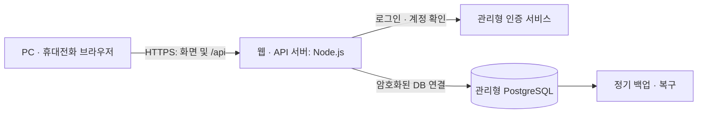

# 온라인 업무 수첩 웹서비스 전환 검토서

검토일: 2026-10-21 · 상태: 설계 제안, 미구현

후속 구현 안내: 이 문서는 최초 검토 기록입니다. 현재 코드는 Vercel Functions + Supabase PostgreSQL, SMS 없는 자체 휴대폰 번호·비밀번호 인증으로 구현했습니다. 기존 제안과 다른 실제 스키마·연결·제약은 [DB_SETUP.md](DB_SETUP.md), [PRD.md](PRD.md), [PHONE_AUTH_PLAN.md](PHONE_AUTH_PLAN.md)를 우선 참고하세요. 운영 연결은 환경 변수 설정 및 배포 후 검증합니다.

## 1. 검토 결론

기존 화면을 유지하면서 **Node.js API 서버 + 관리형 PostgreSQL + 사용자 로그인**을 추가하는 구성을 권장합니다. 화면 파일을 웹서버에 올리기만 하면 접속은 가능하지만, 현재의 localStorage 저장은 기기마다 분리되므로 온라인 DB 서비스가 되지는 않습니다.

초기 운영안은 여러 사용자가 가입하되 각자 본인 일정만 확인하는 개인 수첩입니다. 동일한 계정으로 PC와 휴대전화에서 같은 일정을 조회합니다. 팀 공유·관리자 열람은 별도 요구사항으로 결정해야 합니다. 현재 업무/개인 분류는 일정 종류이며 공개 범위를 뜻하지 않습니다.

이 문서는 구조·준비사항 검토 결과입니다. 서버·DB·계정·도메인을 실제 생성하거나 요금을 발생시키지 않았으며, 현재 서비스는 기존 로컬 방식으로 동작합니다.

## 2. 현재 코드에서 확인한 전환 지점

| 현재 구성 | 확인 내용 | 웹서비스 전환 시 조치 |
| --- | --- | --- |
| index.html / style.css | 순수 HTML·CSS 화면 | 기존 일정 화면 유지, 로그인·통신 상태 UI 추가 |
| logic.js | 날짜, 시간 범위, 저장 데이터, 중복 검사 | 사용자 입력 안내에 재사용하고 서버에서도 독립적으로 검증 |
| app.js의 refresh / save | localStorage에서 전체 배열을 읽고 전체 배열 저장 | 기간별 조회·개별 일정 CRUD API로 교체 |
| app.js의 schedules | 전체 데이터가 메모리에 있음 | 조회한 기간의 데이터만 보관, 사용자 전환 시 비우기 |
| overlaps / conflict 검사 | 현재 브라우저가 가진 일정만 검사 | 서버 검사와 DB 시간 중복 제약조건으로 보장 |
| storage 이벤트 | 같은 저장 영역의 탭 변경 반영 | 저장 후 재조회, 탭 복귀 시 재조회로 시작 |
| 저장 키 | online-work-notebook.standalone.v1 | 기존 데이터 가져오기에서만 사용, 온라인 저장의 기준은 DB |
| 사용자·소유자 | 구분 없음 | 로그인 사용자 ID를 각 일정의 소유자로 저장 |
| test.html / smoke-test.cjs | 규칙과 모의 화면 테스트 | API·실제 DB·권한·동시 요청 테스트 추가 |

현재처럼 전체 일정 배열을 보내 덮어쓰는 API는 만들지 않습니다. 두 기기에서 각각 저장할 때 상대방이 추가한 일정이 사라질 수 있기 때문입니다.

## 3. 권장 구조



화면과 API는 같은 도메인에서 제공하는 방식을 권장합니다. 예를 들어 `https://수첩도메인/`은 화면을, `/api/schedules`는 일정 API를 제공합니다. 인증 쿠키와 접근 정책을 한곳에서 관리할 수 있습니다. DB는 브라우저가 직접 접속하지 않으며, DB 연결 정보는 서버의 비밀 설정으로만 보관합니다.

| 구성요소 | 제안 | 선택 이유 및 조건 |
| --- | --- | --- |
| 화면 | 기존 HTML·CSS·JavaScript | 화면을 다시 만들지 않고 저장·인증 흐름 중심으로 전환 |
| 서버 | 지원 중인 Node.js LTS + HTTP API 프레임워크 | 기존 JavaScript와 언어 통일, 입력 검증·권한·오류 처리 담당 |
| 호스팅 | HTTPS와 Node 실행을 지원하는 관리형 호스팅 | 인증서, 프로세스 재시작, 배포·로그 기능 확인 후 선정 |
| DB | 관리형 PostgreSQL | 사용자 관계, 트랜잭션, 시간 중복 제약조건 활용 |
| 인증 | 관리형 인증, 예: Supabase Auth | 비밀번호 보관·복구를 직접 구현하는 부담 축소 |
| DB 공급자 후보 | Supabase PostgreSQL | 인증과 DB를 함께 운영하는 초기 후보. 지역·비용·백업 조건 확인 후 확정 |

Supabase를 쓰더라도 이 권장안은 브라우저가 DB API를 직접 호출하는 구조가 아닙니다. 서버가 인증 서비스와 DB를 사용합니다. 계정·프로젝트 소유권은 운영자에게 두고, 사용하지 않는 공개 Data API 접근은 비활성화하거나 권한으로 차단합니다. [Supabase 데이터 보안 안내](https://supabase.com/docs/guides/database/secure-data)

관리형 인증은 이메일·비밀번호나 소셜 로그인 등을 제공합니다. 어떤 방식을 사용할지는 운영 대상에 맞춰 결정합니다. [Supabase Auth 공식 문서](https://supabase.com/docs/guides/auth)

대안으로 정적 화면 + Supabase Auth/Data API + RLS를 사용하면 별도 Node 서버를 줄일 수 있습니다. 대신 브라우저 직접 접근을 전제로 모든 CRUD 정책·DB 함수·권한 테스트를 설계해야 합니다. 운영 방식이 확정되기 전에는 두 접근 경로를 혼용하지 않습니다. 기존 회사 서버가 있으면 동일 구조를 그 서버에 배치하는 방안도 가능합니다.

## 4. 데이터베이스 설계안

### 기본 테이블

| 테이블 | 주요 필드 | 용도 |
| --- | --- | --- |
| 인증 공급자의 사용자 저장소 | 사용자 ID, 로그인 식별자, 인증 정보 | 관리형 인증이 담당. 서비스 테이블에 비밀번호 복사 금지 |
| profiles | id(UUID), display_name, timezone, created_at | 사용자 설정. 인증 사용자 ID와 1:1 연결 |
| schedules | 아래 표 참조 | 사용자별 일정 |
| app_sessions | 세션 ID 해시, user_id, 만료, 암호화된 인증 토큰 | 서버 세션. 검증된 세션 구현 또는 적절한 관리형 저장소 사용 |
| import_batches | user_id, batch_key, 상태, 결과 | 기존 데이터 이전을 제공할 때 재시도·중복 가져오기 관리 |

`profiles.id`는 인증 공급자 사용자 ID를 사용합니다. Supabase 채택 시 `auth.users.id`와 연결합니다. 이메일 주소를 일정 소유자 키로 사용하지 않습니다. 계정 탈퇴 시 일정 삭제·보존 및 세션 폐기 정책을 정하고 외래키 동작과 맞춥니다.

### schedules 필드

| 필드 | 제안 타입 | 규칙 |
| --- | --- | --- |
| id | uuid | 서버에서 생성하는 기본키 |
| user_id | uuid | 필수, 사용자 참조, 요청 본문이 아닌 인증 세션에서 결정 |
| category | text | work 또는 personal |
| schedule_date | date | 서비스 현지 날짜 |
| start_minute | integer | 자정부터 분 단위, 420~1350, 30의 배수 |
| end_minute | integer | 450~1380, 30의 배수, 시작보다 큼 |
| content | text | 공백 정리 후 1~200자, 길이 기준은 클라이언트·서버·DB 간 통일 |
| version | integer | 최초 1, 변경 때 증가, 이전 화면의 덮어쓰기 방지 |
| created_at | timestamptz | 서버 생성 시각 |
| updated_at | timestamptz | 서버 변경 시각 |

일정 날짜·시간은 현재처럼 하루 안에 끝나는 일정으로 제한합니다. 초기 기준 시간대는 `Asia/Seoul`을 권장하며, 해외 사용자·자정 넘는 일정을 지원하려면 구현 전에 시간 모델을 재검토합니다. 생성·수정 시각은 UTC 기준으로 보관하고 표시할 때 변환합니다.

### DB에서 보장할 규칙

1. 필수 필드, 분류, 시간 범위·단위·순서, 내용 길이에 제약조건을 둡니다.
2. 동일 사용자·동일 날짜 안에서 시간 구간이 겹치지 않게 합니다. 서로 다른 사용자는 같은 시간에 각각 일정을 가질 수 있습니다.
3. `(user_id, schedule_date, start_minute)` 조회 인덱스를 둡니다.
4. 날짜 조회에는 항상 사용자와 기간 조건을 적용합니다.

중복 방지는 PostgreSQL의 범위와 배제 제약조건으로 구현할 수 있습니다. `[시작, 종료)` 구간을 사용하면 09:00~09:30과 09:30~10:00은 함께 저장할 수 있습니다. [PostgreSQL 범위·배제 제약조건](https://www.postgresql.org/docs/current/rangetypes.html)

아래는 제약조건의 설계 예시이며, 실행 가능한 전체 DB 생성 스크립트는 아닙니다. 실제 마이그레이션에서는 테이블, 권한, 정책, 확장 설치 위치와 지원 여부를 함께 검증합니다.

```sql
-- 전제: btree_gist 확장 설치 및 schedules 테이블 생성 완료
ALTER TABLE schedules ADD CONSTRAINT schedules_no_overlap
EXCLUDE USING gist (
  user_id WITH =,
  schedule_date WITH =,
  int4range(start_minute, end_minute, '[)') WITH &&
);
```

애플리케이션에서 먼저 중복을 확인했더라도 동시에 두 요청이 들어올 수 있으므로 최종 보장은 DB에서 합니다. 제약 충돌은 API가 사용자에게 이해 가능한 409 오류로 변환합니다. 초기 삭제는 현재와 같은 실제 삭제로 제안합니다. 휴지통·복구가 필요하면 `deleted_at`과 활성 일정만 대상으로 하는 중복 제약을 함께 설계합니다.

### 사용자별 접근 분리

서버에서 모든 요청의 소유자를 검사하고, DB에도 행 단위 접근 정책(RLS)을 적용하는 것을 권장합니다. RLS는 사용자별로 조회·변경 가능한 행을 제한하지만, 테이블 소유자나 우회 권한이 있는 계정에는 예외가 있으므로 실제 실행 계정이 중요합니다. [PostgreSQL RLS 문서](https://www.postgresql.org/docs/current/ddl-rowsecurity.html)

권장 서버 직접 연결안에서는 마이그레이션용 계정과 런타임 계정을 분리합니다. 런타임 계정은 테이블 소유자·슈퍼유저·BYPASSRLS 계정으로 사용하지 않습니다. 검증한 사용자 ID를 매 트랜잭션의 로컬 컨텍스트에 설정하고, 정책에서 그 값과 `user_id`를 비교합니다. 연결 풀에서 사용자 컨텍스트가 다음 요청으로 남지 않도록 트랜잭션 범위를 지킵니다. 컨텍스트 누락 시 접근을 거부해야 합니다.

Supabase의 `auth.uid()` 정책은 사용자 JWT가 전달되는 접근 경로에서 사용하는 방식입니다. 서버의 일반 SQL 연결에 자동으로 사용자 ID가 전달된다고 가정하면 안 됩니다. 인증 방식·쿼리 경로·DB 정책을 하나의 통합 테스트로 확인해야 합니다.

## 5. API와 화면 변경

| API 예시 | 역할 | 핵심 조건 |
| --- | --- | --- |
| POST /api/auth/login | 로그인 및 서버 세션 생성 | 요청 제한, 로그인 실패 안내 |
| POST /api/auth/logout | 세션 폐기 | 서버 세션·쿠키 폐기 |
| GET /api/me | 현재 사용자 확인 | 미로그인 401 |
| GET /api/schedules?from=...&to=...&category=... | 기간별 조회 | 본인 소유만, 기간 상한 설정 |
| POST /api/schedules | 일정 등록 | 서버 검증, DB 중복 방지, 재시도 시 중복 처리를 막는 요청 키 지원 |
| PATCH /api/schedules/:id | 일정 변경 | 소유자 확인, 기대 version 일치 시만 변경 |
| DELETE /api/schedules/:id | 일정 삭제 | 소유자 확인, 기대 version 확인 |
| POST /api/imports | 기존 일정 가져오기 | 로그인 필요, 미리보기 후 확정, 일괄 트랜잭션 |

가입·초대·비밀번호 재설정·소셜 콜백 경로는 로그인 방식 선정 후 추가합니다. API 응답의 필드는 현재 화면의 `date`, `start`, `end`와 매핑해 유지할 수 있습니다. DB의 분 단위 값은 API 경계에서 HH:mm으로 변환합니다.

`user_id`는 클라이언트가 지정하거나 바꾸지 못하게 합니다. 없는 일정과 다른 사람의 일정은 모두 404로 처리해 타인의 일정 존재를 노출하지 않습니다. 입력 오류는 400, 미로그인은 401, 시간 충돌·수정 버전 충돌은 409, 과도한 요청은 429로 구분합니다. 내부 SQL·토큰·접속 문자열은 응답에 포함하지 않습니다.

일정 변경은 `WHERE id = ... AND user_id = ... AND version = ...` 조건으로 원자적으로 갱신합니다. 한 기기에서 먼저 수정하면 오래된 버전으로 저장하려는 다른 기기에 재조회 안내를 제공합니다. 네트워크 시간 초과 뒤 등록을 다시 눌러도 중복 생성되지 않도록, 사용자별 요청 키와 결과를 DB 트랜잭션에 함께 기록하는 방식을 설계합니다.

화면에는 로딩·빈 목록·조회 실패·저장 중·저장 실패를 구분합니다. 통신 실패를 빈 일정이나 저장 성공으로 표시하지 않습니다. 실패 시 폼을 유지하고, 저장 완료는 서버 응답 후 표시합니다. 로그아웃·사용자 변경 시 이전 사용자의 메모리·화면을 비웁니다. 초기에는 저장 완료·탭 복귀·수동 새로고침 시 조회하고, 실시간 협업은 필요할 때 추가합니다.

## 6. 로그인·보안·운영 준비

| 항목 | 필요한 작업 |
| --- | --- |
| 접속 대상 | 공개 가입, 초대된 사용자, 사내 계정 중 선택 |
| 로그인 | 이메일/비밀번호, 이메일 링크, 소셜 또는 회사 SSO 결정 |
| 세션 | 서버 세션 ID를 Secure·HttpOnly·SameSite 쿠키로 관리, 만료·갱신·로그아웃 처리 |
| 요청 보호 | 상태 변경 요청에 CSRF 방어, Origin 검증, 인증 요청 제한 적용 |
| 전송·비밀 | HTTPS 강제, DB 암호화 연결, 비밀은 호스팅 비밀 저장소에 보관 |
| DB 권한 | 운영·개발 DB와 자격증명 분리, 최소 권한, DB 접속 경로 제한 |
| 입력 | 서버 검증, 매개변수 SQL, textContent 표시 유지, 요청 크기 상한 |
| 계정 운영 | 본인 확인·비밀번호 복구·계정 탈퇴, 필요한 경우 MFA |
| 메일 | 인증·복구 메일용 발송 설정, 도메인 인증, 도달 여부 테스트 |
| 모니터링 | 오류율·지연·DB 연결 수·용량·백업 실패 알림, 일정 본문·토큰 로그 제외 |
| 개인정보 | 수집 항목·사용 목적·보관 기간·삭제 절차·운영자 연락처 정리 |

쿠키 속성과 세션 만료·폐기는 [OWASP 세션 관리 가이드](https://cheatsheetseries.owasp.org/cheatsheets/Session_Management_Cheat_Sheet.html)를 기준으로 구현합니다. SameSite만으로 모든 CSRF 방어를 대체하지 않으며, 선택한 인증 방식에 맞는 방어를 적용합니다. [OWASP CSRF 가이드](https://cheatsheetseries.owasp.org/cheatsheets/Cross-Site_Request_Forgery_Prevention_Cheat_Sheet.html)

세션은 서버 인스턴스의 메모리에만 두지 않습니다. 재시작·다중 인스턴스에서도 유지할 수 있는 저장소를 사용합니다. 인증 공급자의 갱신 토큰을 서버에 보관하면 별도 키로 암호화하고 노출·회전 정책을 둡니다. 회사 내부 자료를 입력할 경우 조직의 외부 클라우드·데이터 저장 지역 정책도 공급자 선택 전에 확인합니다.

## 7. 기존 데이터 이전

파일을 웹서버에 배포해도 기존 브라우저의 localStorage가 DB로 옮겨지지는 않습니다. 특히 로컬 파일 주소와 HTTPS 서비스는 저장 영역이 다릅니다.

1. 기존 일정이 보이는 로컬 실행 위치에서 JSON 내보내기를 추가합니다. 파일 접근 위치가 바뀌어 일정이 안 보이면 이전 브라우저·경로부터 확인합니다.
2. 온라인 서비스에 로그인한 사용자가 파일을 선택하고 이전할 일정·오류·겹침을 미리 확인합니다.
3. 서버가 날짜·시간·내용과 기존 온라인 일정의 충돌을 검증합니다. 기존 ID는 불투명한 문자열일 수 있으므로 그대로 UUID 필드에 넣지 않고 새 ID를 발급합니다.
4. 사용자와 가져오기 작업 키로 중복 제출을 방지합니다. 초기안은 오류가 하나라도 있으면 전체 가져오기를 취소하고 결과를 안내합니다.
5. 성공 후 건수와 일부 일정을 대조합니다. 검증 완료 전 원본 파일·기존 브라우저 데이터를 삭제하지 않습니다.

사용자가 다른 출처의 데이터를 가져와도 소유자는 현재 로그인 사용자로 고정합니다. 이전할 데이터가 없으면 가져오기 기능은 후속 단계로 미룰 수 있습니다.

## 8. 배포·백업과 비용

### 배포 준비

- 서비스 계정: 호스팅, DB/인증 공급자, 도메인·DNS, 인증 메일 발송
- 환경: 개발·검증·운영 분리, 운영 데이터가 테스트에 섞이지 않도록 구성
- 서버 비밀: DB 연결 정보, 인증 공급자 설정, 세션 암호화 키, 운영 URL
- 배포: 버전 관리 → 테스트 → DB 마이그레이션 → 서버 배포 → 기본 동작 확인
- 노출 범위: 화면 파일만 정적 공개. 서버 소스·환경 파일·SQL·문서·테스트는 공개 디렉터리에서 제외
- 복구: 이전 앱 버전으로 복구할 방법과 DB 변경의 호환성 계획 마련

### 백업 목표 제안

초기 목표는 하루 1회 이상 백업, 별도 보관, 정기 복구 연습입니다. 임시 목표는 최대 하루 분량 손실 허용(RPO 24시간), 4시간 내 복구(RTO 4시간)로 두되 업무 중요도와 비용에 따라 확정합니다. 이는 공급자가 보장한 수치가 아니라 운영 목표안입니다. 더 적은 데이터 손실이 필요하면 시점 복구(PITR)를 검토합니다. 관리형 서비스의 플랜별 백업·복구 범위를 확인하고, 다른 검증 DB로 실제 복원해 확인해야 합니다. [Supabase 백업 안내](https://supabase.com/docs/guides/platform/backups)

### 예상 비용 항목

| 항목 | 과금·확인 기준 |
| --- | --- |
| 웹/API 호스팅 | 실행 시간·메모리·요청·트래픽, 유휴 중지 여부 |
| DB·인증 | 컴퓨팅·저장량·접속 수·인증 사용자·전송량 |
| 도메인 | 연간 등록·갱신 비용 |
| 인증 메일 | 발송 건수·발신 도메인 설정 |
| 백업·모니터링 | 보관 기간, 외부 백업 저장소, 로그·알림 |
| 운영 작업 | 업데이트, 장애 대응, 계정 관리, 복구 점검 |

2026-10-21 확인한 Supabase 공식 가격표에서 Free는 월 $0, Pro는 월 $25부터이며, Free는 1주 비활동 시 일시 중지 조건이 명시되어 있습니다. 실사용 서비스에는 중지·백업·용량 조건을 확인한 운영 플랜을 선택하는 것을 권장합니다. 이 금액은 Supabase 기준 시작 가격으로 웹서버·도메인·메일·추가 사용량·세금 등을 합친 전체 견적이 아닙니다. [공식 가격표](https://supabase.com/pricing)

정확한 월 견적은 사용자 수, 동시 접속, 저장 기간, 사용 지역, 공급자와 플랜을 결정한 후 계산합니다. 사용량 알림과 예산 한도를 설정하고, 모든 비용 항목에 제한이 적용되는지 확인합니다. [Supabase 비용 한도 안내](https://supabase.com/docs/guides/platform/spend-cap)

## 9. 구현 순서와 완료 기준

| 단계 | 작업 | 완료 기준 |
| --- | --- | --- |
| 1. 범위 확정 | 사용자·공유·로그인·예산·운영 위치 결정 | 아래 결정표 확정 |
| 2. 기반 구성 | 서버 프로젝트, 검증 DB, 인증, 마이그레이션·권한 | 로그인 성공, 사용자별 DB 접근 분리 확인 |
| 3. 일정 API | 조회·등록·변경·삭제, DB 제약, 버전 충돌 처리 | 동시 등록에도 겹치는 일정 하나만 저장 |
| 4. 화면 연결 | localStorage 동작을 API로 전환, 상태·오류 UI | 같은 계정으로 두 기기에서 같은 데이터 확인 |
| 5. 이전·운영 | 필요 시 가져오기, 백업·알림·배포 절차 | 가져오기 재시도·복구·오류 대응 검증 |
| 6. 공개 | 도메인·HTTPS, 운영 점검 | 권한·동시성·실제 브라우저 테스트 통과 후 오픈 |

추가 검증에는 사용자 A가 B의 ID로 조회·수정·삭제하지 못하는지, 미로그인 차단, 동일 시간 동시 등록, 오래된 version 변경 거부, 통신 실패 후 재시도, 세션 만료·로그아웃, 연결 풀 사용자 컨텍스트 누수 방지, 실제 DB 백업 복원을 포함합니다. 현재의 규칙 테스트 25개와 모의 화면 테스트만으로 온라인 서비스 운영 준비가 완료되지는 않습니다.

현재 화면에 추가된 상단 D-day 목록은 오늘부터 7일 후까지 전체 분류의 일정이 필요합니다. 온라인 전환 시 선택한 달·주 데이터와 별도로 해당 범위를 조회하고, 조회 실패를 빈 목록으로 표시하지 않아야 합니다. 날짜 기준 시간대도 서버·화면에서 일치시킵니다.

## 10. 구현 전에 결정할 사항

| 질문 | 권장 초기안 | 결정에 따른 영향 |
| --- | --- | --- |
| 본인만 사용 / 여러 사용자 / 팀 공유? | 여러 사용자, 각자 본인 일정 | 팀 공유면 조직·멤버·캘린더·권한 테이블 추가 |
| 누구나 가입 / 초대 / 회사 계정? | 소규모 검증은 초대 방식 | 가입·관리·인증 방식 변경 |
| 로그인 수단은? | 기존 운영 계정 체계가 있으면 우선 연동 | 없으면 관리형 이메일 인증 등 선택 |
| 서버·클라우드 계정이 이미 있는가? | 기존 운영 환경 확인 후 선정 | 호스팅·DB·네트워크·배포 방식 결정 |
| 월 예산과 예상 사용자 수는? | 검증 후 운영 플랜 선택 | 컴퓨팅·DB·백업·메일 비용 산정 |
| 기존 일정은 이전해야 하는가? | 필요 시 사용자별 1회 가져오기 | 내보내기·검증·중복 방지 구현 추가 |
| 일정 기준 시간대는? | Asia/Seoul | 해외·여러 시간대면 날짜 모델 재검토 |
| 삭제 후 복구·보관이 필요한가? | 현재와 같은 실제 삭제 | 휴지통·감사 기록·보관 정책 추가 |

팀 공유를 선택하면 중복 기준을 '개인별'로 유지할지 '공유 캘린더·자원별'로 바꿀지도 결정해야 합니다. 개인 일정이 공유 화면에 나타나는 범위를 명확히 정한 뒤 DB와 API 권한을 구현합니다.

다음 구현 산출물은 `server/`, `db/migrations/`, 온라인 API 연동 화면, 환경 변수 예제(실제 비밀 제외), 배포·백업 안내, API/DB 통합 테스트가 됩니다. 현재 문서는 해당 구현의 출발점이며, DB 생성 스크립트와 배포 파일은 범위·공급자 확정 후 작성합니다.
